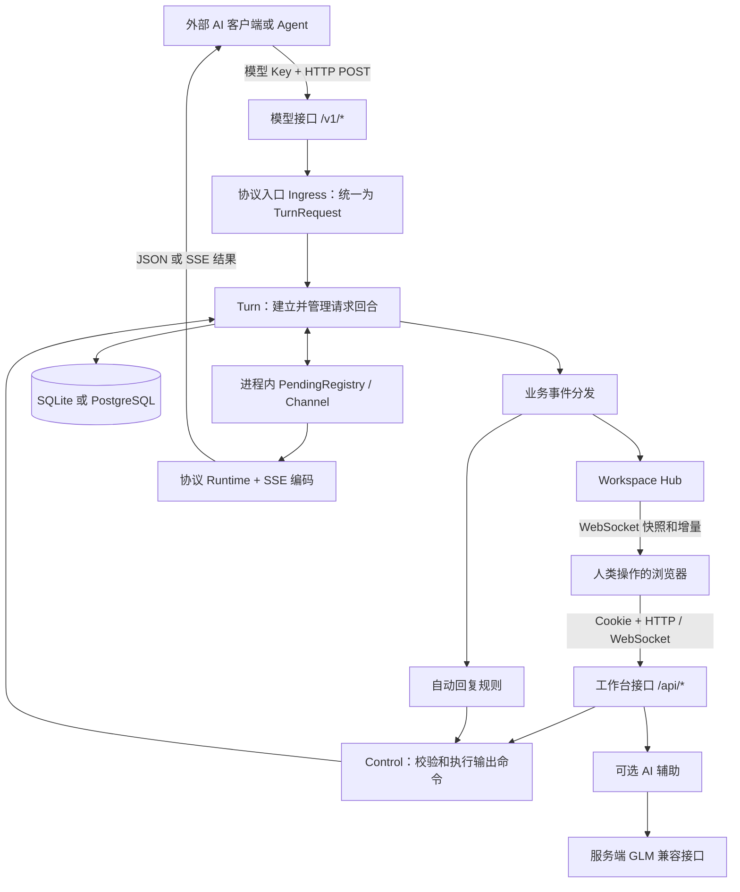
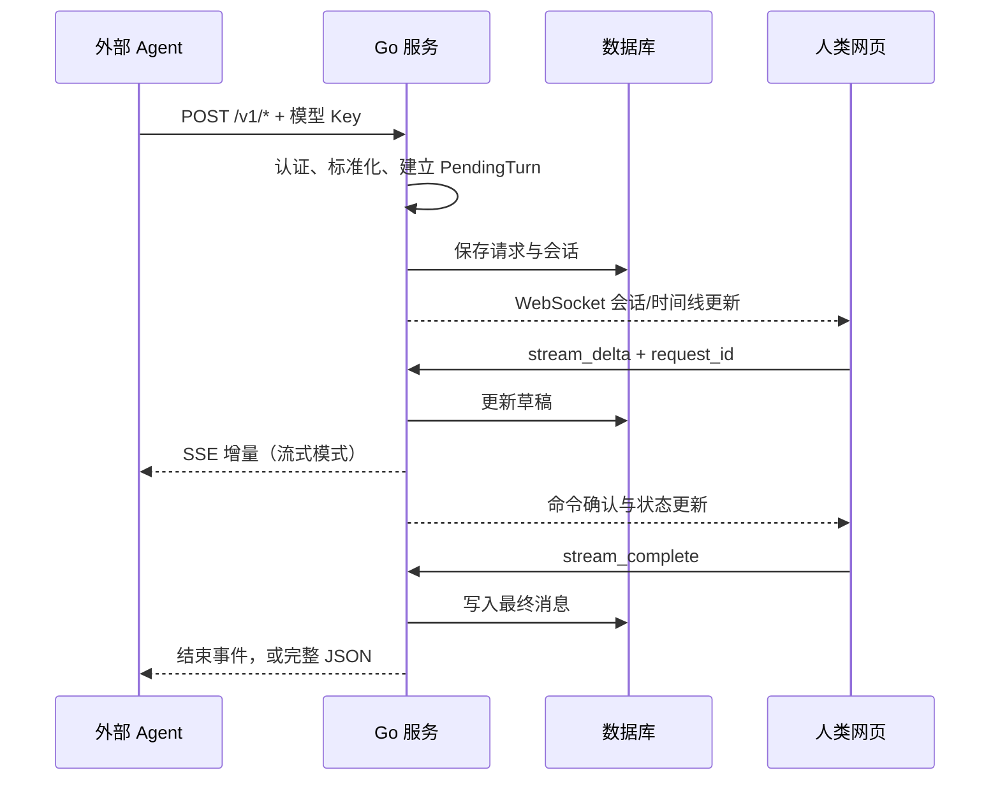

# ChatAPI：项目原理、网站搭建与面试问答

编写日期：2026-10-27。依据：当前工作区源码、部署配置和定向测试。

适合阅读方式：先读第 1—4 章建立整体认识，再读第 5—9 章理解技术细节，最后用第 12—14 章练习讲述和面试。

本文中的“已实现”以当前代码为准；“建议”“可改进”是后续设计，不代表仓库已经具备。接口示例使用占位 Key，不包含本机真实配置。本文讲解搭建流程，没有执行部署、修改现有业务配置或访问真实用户数据。

## 目录

1. 项目究竟解决什么问题
2. 从上到下看整体架构
3. 一次模型调用的完整旅程
4. 网站从浏览器地址到页面呈现的原理
5. 后端分层、并发与状态机
6. 三套模型协议、流式输出与工具调用
7. 数据库、权限、密钥与媒体
8. 前端状态、实时同步与自动化
9. 从零复建网站的开发顺序
10. 本地开发、单二进制与 Docker 部署
11. 域名、HTTPS、反向代理、迁移与排错
12. 六个贯穿项目的实践示例
13. 四十个面试问答
14. 项目介绍话术与学习路线
15. 源码导航、测试记录与参考资料

## 1. 项目究竟解决什么问题

### 1.1 一句话说明

**ChatAPI 把人类的回复包装成兼容模型协议的 HTTP API，让外部 AI 客户端或 Agent 可以像调用模型一样调用你。**

普通 AI 产品的方向是：用户在网页问问题，服务器调用大模型，大模型回答。

本项目的主链路是：外部程序发起模型请求，服务器把请求送到人的网页工作台，人来决定回复内容，服务器将结果编码后交回外部程序。

因此，网页里的你通常在扮演 assistant，而外部 Agent 在等待“模型返回”。项目还可作为 Mock LLM，帮助测试 Agent 的文本输出、工具调用和异常处理。

### 1.2 举一个最直观的例子

假设某个 Agent 配置：

```text
API Base URL = http://127.0.0.1:5000/v1
API Key      = 在 ChatAPI 中创建的模型 Key
Model        = human-assistant（示例名称）
```

Agent 问：“请给这篇文章写摘要。”

此时请求进入 ChatAPI，你在 `/app` 工作台看到它。你输入摘要并结束输出，Agent 收到符合其所选接口格式的 assistant 消息，继续执行后续任务。

模型名在这里主要是协议和业务标识，不代表服务器真的加载了一套同名模型权重。`/v1/models` 的列表由用户的虚拟模型记录生成；认证归属主要由模型 Key 决定，不要把模型名误认为密码或权限凭证。

### 1.3 核心能力和辅助能力

| 能力 | 在项目里的作用 |
|---|---|
| 人工回复 | 人来决定文字、思考片段、工具调用等输出 |
| 协议兼容 | 对接 Chat Completions、Responses、Anthropic Messages |
| Web 工作台 | 展示会话、请求参数、工具定义和操作状态 |
| 自动回复规则 | 匹配请求后按规则回放动作，可用于重复测试 |
| AI 代写与工具填参 | 可选的后端模型辅助能力，默认配置指向 GLM |
| 用户与管理员功能 | 登录、Key、访问控制、设置、审计与监控 |
| 图片和存储 | 处理输入图片、回复图片及媒体引用 |

核心链路不要求配置 GLM。GLM 用于生成候选内容和填参，和“外部 Agent 调用人类”的主链路是两个方向的调用。

## 2. 从上到下看整体架构

### 2.1 架构图



没有 Mermaid 渲染器时，把图理解为三件事：外部调用进来、网页操作进来、服务端把两者连接起来。

### 2.2 技术栈分别负责什么

| 技术 | 项目中的职责 | 为什么需要 |
|---|---|---|
| React | 组件、页面、交互和 UI 状态 | 把服务器状态呈现为可操作的工作台 |
| TypeScript | 前端类型约束 | 减少命令字段和事件结构用错的情况 |
| Vite | 开发服务、代理、生产构建 | 让源码能在开发中运行、在生产中分发 |
| Ant Design | 表单、弹窗、表格等 | 复用基础交互组件 |
| React Router | `/login`、`/app`、`/help` 等页面路由 | 支持单页应用里的地址导航 |
| Go + chi | HTTP 服务、中间件、业务入口 | 处理请求和长连接 |
| gorilla/websocket | 工作台双向实时连接 | 接收服务器事件并发送用户命令 |
| SSE | 模型接口的单向流式输出 | 将增量内容持续交给模型客户端 |
| SQLite / PostgreSQL | 持久化 | 保存用户、会话、消息、配置、媒体引用等 |
| Docker 多阶段构建 | 打包和部署 | 产出带前端资源的后端镜像 |

依赖版本以 `frontend/package-lock.json` 和 `backend/go.mod` 为准。当前 Dockerfile 使用 Node 24、Go 1.26 构建；本机复建时可以参照它们，不要只根据旧教程选择版本。

### 2.3 这是微服务吗

从当前源码看，更合适的描述是：**前后端分离开发、可合并部署的模块化单体应用。**

后端目录虽然拆分了鉴权、聊天、自动化、存储等模块，它们默认仍运行在同一个 Go 进程里。Go 还可以同时托管前端静态文件。

“分层清楚”不等于“已经拆成微服务”；“支持 PostgreSQL”也不等于“已经支持多实例共享实时状态”。

## 3. 一次模型调用的完整旅程

这一章是理解项目最重要的部分。

### 3.1 第一步：外部程序发起 HTTP 请求

例如请求 `POST /v1/chat/completions`，请求体包含 `model`、`messages` 和 `stream`，请求头携带模型 Key。

路由由 `backend/internal/http/router/protocol_routes.go` 注册。serve 模式下先经过模型 Key 认证和主体访问检查，再进入处理器。

### 3.2 第二步：识别调用归属

模型 Key 对应某个用户。认证结果写入请求的 context，其中带有主体及 Actor 信息。后续业务从 context 获取 owner，而不应相信客户端随意提交的 owner 字段。

这一点决定：请求应该出现在谁的工作台上。

### 3.3 第三步：把不同接口转成统一结构

`ChatAPIHandler.handleProtocolRequest` 读取 JSON，调用 `Ingress.Parse`，后者通过 `protocol.NormalizeRequest` 建立统一的 `TurnRequest`。

统一结构包括：协议、模型、是否流式、用户文本、系统内容、工具 Schema、工具选择、输出参数、原始请求等。

三个接口的 JSON 形状不同，但后续建立等待回合的逻辑可以共享。就像不同国家的电源插头先经过转接头，再连接同一台设备。

### 3.4 第四步：确定新会话还是续接会话

`conversationresolve.Service.Resolve` 大致按以下顺序工作：

1. 有显式 `conversation_id`：查对应会话，验证归属和协议兼容。
2. 输入中有工具结果的 call ID：在当前用户范围内查内存索引或数据库记录。
3. 没找到可复用目标：创建新会话。

不要据此推断它已经实现任意聊天历史的智能去重，或者只靠 `previous_response_id` 就一定能够恢复所有上下文。

### 3.5 第五步：持久化并建立等待回合

`turn.Submitter.Submit` 负责准备请求和图片、创建输出策略、生成标识、落库并登记运行时对象。

主要标识的含义：

| 标识 | 回答的问题 |
|---|---|
| owner ID | 属于哪个用户？ |
| conversation ID | 属于哪个会话容器？ |
| request ID | 是该会话里的哪一次请求？ |
| response ID | 本次协议响应用什么标识？ |
| tool call ID | 某个工具调用与工具结果如何对应？ |
| command ID | 浏览器发出的哪条命令正在等待确认？ |

创建的 `PendingTurn` 中有 `Events` 和 `Done` 两个 Go channel。当前代码分别使用容量 32 和 1。

数据库保存持久事实；内存对象负责让当前等待中的请求和输出动作建立联系。

### 3.6 第六步：通知网页

Turn 服务发布会话更新、消息追加、回合等待等业务事件。Workspace 相关订阅者将它们投递到用户的 WebSocket 连接。

网页建立连接时先接收 `workspace.snapshot`，随后接收 `conversation.upsert`、`timeline.reset`、`timeline.append` 等事件。

快照回答“现在是什么状态”，增量回答“刚才发生了什么变化”。

### 3.7 第七步：人在网页回复

前端的 `useChatWorkspace` 组织回复命令，`useWorkspaceRealtime` 通过 `/api/ws` 发送。例如：

```json
{
  "type": "workspace.command",
  "command": {
    "command_id": "cmd_example_1",
    "kind": "stream_delta",
    "conversation_id": "conv_example",
    "request_id": "req_example",
    "mode": "answer",
    "text": "你好，这是第一段回复。"
  }
}
```

这段是结构示意；真实 ID 应来自当前快照，不能把示例 ID 直接当成有效业务对象。

服务端 Workspace 将命令转换为统一 Control 命令；Control 校验归属、按会话串行执行，再调用 Turn。

### 3.8 第八步：先处理输出，再生成协议事件

Turn 处理输出限制、更新草稿或最终消息，然后调用 `protocolruntime.Runtime` 把动作编码成对应协议的流事件。

同一段文字，在 Chat Completions 中可以是 `choices[].delta.content`，在 Responses 中对应 `response.output_text.delta` 事件，在 Anthropic 中对应 content block 相关事件。

协议状态不只是把字段改个名字，还涉及开始、增量、结束、工具调用和内容块索引。

### 3.9 第九步：外部程序收到结果

流式请求持续读取 `Events`，写出 SSE 数据并 Flush。

非流式请求通过 `WaitTurn` 等待 `Done`，最终返回完整 JSON。**非流式也可能等很久**，因为人还没有回复；它只是没有持续返回增量。

完成后移除 Pending 索引，持久消息保留在数据库中。



## 4. 网站从浏览器地址到页面呈现的原理

### 4.1 访问网站发生了什么

以生产环境 `https://chat.example.com/app` 为例：

1. 浏览器通过 DNS 查域名对应的服务器地址。
2. 浏览器与入口建立连接，完成 HTTPS 的 TLS 握手。
3. 入口将请求交给 Go 服务，或经反向代理转发。
4. Go 返回前端 `index.html`。
5. 浏览器加载 HTML 引用的 JS、CSS 等资源。
6. JS 中的 React 代码运行，把组件挂载到 `#root`。
7. React Router 根据 `/app` 选择对应页面。
8. 前端请求登录会话，建立 WebSocket，接收业务数据。
9. 状态变化触发 React 更新界面。

前端资源负责“界面如何显示和交互”；后端接口负责“真实数据、权限和业务动作”。页面能打开，不代表模型接口、WebSocket、数据库都正常。

### 4.2 为什么刷新 `/app` 不应返回 404

React Router 的页面路由存在于浏览器 JS 中。直接刷新 `/app` 时，HTTP 请求先到服务器；服务器必须把它交回 SPA 的 `index.html`，让浏览器重新启动路由。

当前 `spaFallback`：

- 真正存在的静态文件直接返回。
- `/api`、`/v1` 等后端保留路径不兜底为 HTML。
- 其他可用前端路由回退到 `index.html`。

因此，`/app` 可以由前端接管，而拼错的 `/api/xxx` 应保持接口错误，不应变成 HTTP 200 的首页 HTML。

### 4.3 开发环境为什么有两个端口

```text
浏览器 → Vite 127.0.0.1:5173
             ├─ 页面和模块：Vite 直接响应
             ├─ /api/*：代理到 Go 127.0.0.1:5000
             ├─ /v1/*：代理到 Go 127.0.0.1:5000
             └─ /api/ws：通过 ws:true 支持 WebSocket 代理
```

开发时 Vite 负责模块加载和热更新，Go 负责业务。浏览器通常只请求 5173 来源下的相对地址，代理再转发到 5000。

这个代理是开发服务器的配置；生产构建出的 JS 不会自动携带一台 Vite 代理服务器。

### 4.4 构建究竟做什么

`npm run build` 执行 `tsc -b && vite build`：先做 TypeScript 项目构建检查，再由 Vite 输出供部署使用的前端资源。

当前普通输出是 `frontend/dist`；`build:embedded` 把资源写到后端 `internal/http/webassets/dist`，供 Go embed 使用。

React 是界面库，Vite 是构建与开发工具，Go 是业务服务，三者解决不同问题。Vite 的生产构建机制可参阅 [官方文档](https://vite.dev/guide/build.html)。

## 5. 后端分层、并发与状态机

### 5.1 入口和组装

后端入口是 `backend/cmd/server/main.go`。

```text
main/run
  → 识别 serve / lab 模式
  → 创建受系统信号控制的 context
  → bootstrap.New
     → 加载配置
     → 初始化日志、图片处理和数据库
     → 执行数据库迁移
     → 组装鉴权、聊天、用户、管理员模块
     → 清理重启前遗留的等待状态
  → App.Run
     → 启动后台维护任务和 HTTP 服务
```

bootstrap 相当于应用的装配车间：创建对象并注入依赖，业务服务本身不必到处寻找全局变量。

### 5.2 各层的边界

| 层 | 典型目录 | 职责 |
|---|---|---|
| HTTP | `internal/http/router`、`handler`、`middleware` | 路由、认证入口、请求解析、HTTP 输出 |
| 协议 | `internal/protocol` | 统一请求、协议响应、错误结构 |
| 业务 | `internal/service/chat`、`auth`、`automation` | 回合、权限、自动化等业务规则 |
| 仓储 | `internal/repository` | 数据接口及 SQLite、PostgreSQL 实现 |
| 平台 | `internal/platform` | 密码、加密、媒体、邮件、外部模型客户端 |
| 运维 | `internal/ops` | 就绪检查、日志指标、初始化和迁移 |

例如 HTTP 层知道请求头和状态码；Turn 层关注“当前回合能不能完成”；Repository 层关注“这些状态如何可靠落到数据库”。

### 5.3 为什么需要内存和数据库两套东西

数据库记录可以在进程退出后保存，但它无法保存当前 goroutine、HTTP socket 和 Go channel。

PendingRegistry 则用 Map、锁、channel 追踪本进程中的活跃回合，适合快速查找与唤醒等待者，却不能跨重启保留。

所以两者分工是：

```text
数据库：发生过什么、最终状态是什么、下次打开页面要看到什么
内存：谁正在等、输出应该送给哪条活跃连接、当前如何协调并发
```

### 5.4 状态机要分两个层面看

运行时 Pending 状态包括：`pending`、`streaming`、`completing`、`aborting` 等，终结后从注册表移除。

持久会话/页面状态包含：`waiting`、`streaming`、`closed`、`aborted`、`expired`、`disconnected`。

```text
等待 waiting
  ├─ 输出增量 → streaming → 正常完成 closed
  ├─ 主动终止 → aborted
  ├─ 超时 → expired
  └─ 外部请求断开 / 服务重启清理 → disconnected
```

不要把运行时的 `completed` 和页面的 `closed` 当成完全相同的一组枚举；它们描述的层次不同。

### 5.5 并发问题为什么真实存在

即使只有一个人，也可能同时发生：两个网页标签都回复、自动规则回复、外部请求取消、TTL 清理、管理员终止。

当前代码有几道协调措施：

1. Control 使用会话锁，串行执行同一会话的命令。
2. PendingTurn 的 `MutationMu` 协调回合内修改。
3. 注册表通过锁和状态转换阻止已终结回合再次完成。
4. 命令携带 request ID，避免同一个 conversation 已进入下一回合时，旧页面继续写入。
5. 持久化失败时，部分状态转换会回滚；输出 Guard 也只在持久化成功后推进内部状态。

这解决的是当前进程内的协调。不能据此声称跨进程分布式一致性已经完成。

### 5.6 request ID 与 command ID 有什么区别

request ID 绑定业务回合：防止把上一轮的回复写到下一轮。

command ID 关联一次网页命令和服务端 ACK：让 Promise 知道哪次操作成功或失败。

当前前端等待命令确认的超时是 15 秒。超时说明“未及时收到确认”，不能单凭它认定“服务端一定没有执行”。而 command ID 出现在消息里，也不等于后端已经实现持久化幂等去重。

### 5.7 断线和重启如何处理

外部模型请求 context 取消时，Turn 服务执行断开处理，记录事件并更新会话。

启动时 `DisconnectRecoveredPending` 把数据库中遗留的等待回合标为断开，因为原先 socket 和 goroutine 已经不存在。

网页自己的 WebSocket 重连则重新获取快照和时间线。这是恢复页面视图；它并不会复活外部 Agent 原来的 HTTP 请求。

### 5.8 长连接为什么不能照搬普通超时

当前 Go HTTP 服务设置了读取相关超时，但 WriteTimeout 保持为零，源码注释明确指出 SSE 和等待人工回复可能持续数分钟。

仍应按业务设置 Pending TTL、连接数、客户端超时和代理超时。WriteTimeout 为零不等于所有网络链路都会无限等待；上游 SDK、代理、CDN 都可能有自己的限制。

## 6. 三套模型协议、流式输出与工具调用

### 6.1 三套接口的输入输出为什么不同

| 协议入口 | 输入的主要形式 | 输出关注点 |
|---|---|---|
| `/v1/chat/completions` | `messages` | `choices`、message/delta、finish_reason |
| `/v1/responses` | `input`、instructions 等 | response、output item、细分事件 |
| `/v1/messages` | `messages`，另有 system 等 | content block、stop_reason 等 |

项目把它们统一为内部 TurnRequest，再按原协议编码回去。兼容性应按具体字段、事件和测试逐项说明，不能说“与官方所有能力完全一致”。

### 6.2 SSE 的底层格式

SSE 是一个保持打开的 HTTP 响应。服务端持续写文本事件，事件间用空行分隔。

```text
event: response.output_text.delta
data: {"type":"response.output_text.delta","delta":"你好"}

```

上面只展示编码形状，实际事件可能还有响应 ID、索引等字段。

当前 `writeSSEEvent` 序列化内容，`StreamPendingTurn` 每次写完事件后调用 `Flush`，尽快把已写数据交给传输链路。

模型接口通常是 POST 发起，客户端用 SDK 或流式 HTTP 读取。不要认为所有 SSE 都必须由浏览器 `EventSource` 发 GET 请求。

### 6.3 WebSocket 与 SSE 在本项目里的分工

| 比较 | WebSocket | SSE |
|---|---|---|
| 主要连接对象 | 人的网页与后端 | 外部模型客户端与后端 |
| 通信方向 | 双向 | 响应方向单向持续输出 |
| 本项目常见入口 | `/api/ws` | `/v1/*` 请求中的 `stream:true` |
| 承载内容 | 工作台事件、订阅、回复命令、ACK | 协议开始、文本增量、工具事件、结束 |
| 恢复方式 | 重连后重建快照和订阅 | 本次请求断开后通常由调用端重新发起 |

管理员监控还使用了另一条 SSE 接口 `/api/admin/monitor/stream`。所以“SSE 只用于模型输出”也不够准确。

### 6.4 为什么终结时容易重复文本

例如已经发出两段：`你`、`好`。最终状态里的全文是 `你好`。如果完成时又把全文当新增文本发一次，客户端会拼成 `你好你好`。

当前设计区分持久化聚合结果、输出片段和协议 Runtime 状态，相关测试覆盖增量与最终结果的一致性。讲解时要强调“全文快照”和“增量”语义不同。

### 6.5 stop 序列为什么要跨片段处理

假设 stop 是 `END`，两次输入分别是 `abcE` 和 `NDxyz`。

如果每次只在本段查找，就都找不到完整的 `END`。Guard 会暂存可能构成 stop 的尾部前缀，例如先保留 `E`；收到下一段后再决定输出与终止。

这也解释为什么某个片段末尾可能暂时不立即出现在外部客户端：它可能还处于 stop 前缀确认阶段。

### 6.6 max_tokens 与 temperature 能力边界

输出 Guard 实际处理 token 预算与 stop，并根据结果决定自动结束和结束原因。

但输入中的 temperature、top_p 等并不会让人类按采样分布作答。代码可以解析和展示参数，不代表已经实现模型采样机制。

未知模型及部分协议的 token 计数使用估算能力；应查看记录中的计数器和 accuracy 标记。这里的输出计数不能等同于真实提供商的完整账单统计。

### 6.7 工具调用不是普通文字

假设 Agent 声明工具：

```json
{
  "type": "function",
  "function": {
    "name": "get_weather",
    "description": "查询城市天气",
    "parameters": {
      "type": "object",
      "properties": {"city": {"type": "string"}},
      "required": ["city"]
    }
  }
}
```

你在网页选择 tool_call、填写 `city=上海`，服务端返回结构化调用。Chat Completions 中的 arguments 通常是 JSON 字符串，例如 `"{\"city\":\"上海\"}"`。

之后通常由外部 Agent 执行工具，再把工具结果随新的模型请求送回来，项目使用 call ID 关联上下文。

**“网页构造了 get_weather 调用”不等于“ChatAPI 已经替你访问真实天气服务”。** 某些 Responses 内置工具输出路径可以模拟专门事件，也不能由此推断平台真的执行了搜索或图片生成模型。

## 7. 数据库、权限、密钥与媒体

### 7.1 数据表怎样支持业务

| 主要数据 | 存储内容 |
|---|---|
| users | 用户、密码摘要、角色和启用状态 |
| user_identities | 外部身份关联 |
| user_api_keys | 模型 Key 相关数据，历史表名 |
| user_app_api_keys | 应用 Key、权限范围及限制 |
| user_virtual_models | 用户虚拟模型列表 |
| conversations | 会话摘要及 metadata 中的实时业务状态 |
| messages | 输入、输出和关联元数据 |
| conversation_events | 断开、终止等可展示事件 |
| config / user_configs | 全局及用户配置 |
| automation_rules | 自动规则 |
| media_assets / 引用与暂存表 | 媒体文件元数据和业务引用 |
| audit_logs 等 | 管理操作与访问审计 |

当前部分请求信息、owner 和状态放在 JSON metadata 中，不要把上面的概念表直接当成已经规范化拆分好的完整 ER 图。

数据库结构由迁移文件逐步建立；只看最早的 `0001_bootstrap` 会漏掉后续字段、索引和媒体表。

### 7.2 SQLite 的实际配置

`sqlite.Open` 设置：

- `SetMaxOpenConns(1)`：当前实例的数据库连接池只允许一个打开连接。
- `journal_mode=WAL`：使用 WAL 日志模式。
- `foreign_keys=ON`：启用外键约束。
- `busy_timeout=5000`：遇到锁等待时允许等待一定时间。

WAL 并不意味着当前应用就能无限并行写数据库；单连接配置仍会使数据库操作在连接层排队。大量等待人工回复的连接也不应一直占住数据库事务。

### 7.3 事务为什么重要

创建回合可能涉及会话、消息、媒体引用等多项写入。若其中一项失败，应避免留下“会话说成功，但消息没有”的半成品。

Repository 在这些复合操作中使用事务，将相关变更一起提交或回滚。业务层还必须协调内存状态，否则可能出现数据库失败而内存已经认为完成的偏差。

### 7.4 分页和索引

工作台会话分页每页 30 条，查询时取 31 条判断是否还有下一页。

游标包含 owner、更新时间和 ID，并用 Base64 URL 编码。排序使用更新时间加 ID，避免相同时间戳缺少稳定排序依据。SQLite 有与 owner、更新时间、ID 对应的表达式索引。

Base64 是编码，不是加密。游标校验 owner 是隔离措施的一部分；真正的权限边界还要依靠查询和服务端归属校验。

### 7.5 三种凭证的区别

| 凭证 | 适用对象 | 常见用途 |
|---|---|---|
| Session Cookie | 浏览器中的人 | 登录工作台和用户操作 |
| 模型 Key | 外部模型客户端 | 调用 `/v1/*` |
| 应用 Key | 外部管理或控制程序 | 按 scopes 读取请求、提交输出等 |

不要把模型 Key 当成所有内部管理接口的通行证。相关路由有不同的认证和权限检查。

### 7.6 密码、API Key、Session 不是同一种处理

密码使用 Argon2id 加随机盐保存摘要，目标是校验而不还原原密码。代码还保留旧 SHA-256 格式的兼容验证及升级标志。

模型 Key 需要支持查看原文，因此使用 master key 派生出的 AES-GCM 密钥加密保存。当前认证路径按前缀定位记录、解密并比较原 Key；不能因为表中已有 key_hash 就声称认证路径完全改成哈希匹配。

Session 使用 `Base64URL(payload).Base64URL(HMAC-SHA256(payload))` 形式的自定义签名令牌，不是标准三段 JWT。签名防篡改，payload 本身不是加密的。

当前 Cookie 默认 HttpOnly、SameSite=Lax；bootstrap 中 SecureOnly 配置为 false。若讨论生产强化，可以提出 HTTPS 配套 Cookie 策略，但不要说代码已经自动按 HTTPS 强制 Secure。

### 7.7 CORS、CSRF 和越权各解决什么

| 问题 | 含义 | 当前项目相关机制 |
|---|---|---|
| CORS | 浏览器能否从一个来源访问另一个来源并读取响应 | 允许来源、方法、请求头及凭证 |
| CSRF | 浏览器自动带 Cookie 时，被其他页面诱导执行操作 | 部分 Session 写接口检查 Origin/Referer |
| 认证 | 调用者是谁 | Cookie、模型 Key、应用 Key |
| 授权与归属 | 这个人能否操作此会话或资源 | policy、scopes、owner 校验 |

前端隐藏按钮只是界面行为，不能替代后端权限检查。

当前 WebSocket upgrader 的 CheckOrigin 直接返回 true，而 Session CSRF 检查跳过 GET。不能声称 HTTP 的 CORS/CSRF 已经严格覆盖了 WebSocket 握手来源；更严格的来源检查是可讨论的改进项。

### 7.8 图片路径

项目区分请求图片预处理、媒体资产和业务引用。内嵌图片可被校验、转码后保存；当前配置注释明确指出远程 http/https 图片 URL 原样保留，不由该路径下载转码。

回复图片先绑定 owner、conversation、request 等身份，再作为输出资产消费，减少上一轮上传误用到下一轮的情况。

跨 Windows/Linux 迁移时，数据库中若存着旧绝对文件路径，需要在停机后的副本上转换，不能只复制图片目录就认为所有引用都会自动生效。

## 8. 前端状态、实时同步与自动化

### 8.1 从入口读前端

```text
main.tsx
  → StrictMode
  → ThemeProvider
  → BrowserRouter
  → Ant Design App
  → App.tsx 路由
  → WorkspaceRoute
  → useChatWorkspace（组织工作台状态与操作）
  → useWorkspaceRealtime（连接、订阅、命令与事件）
```

当前主要依靠 React hooks 管理状态，不能描述成已经使用 Redux 或 Zustand。

### 8.2 useState、useEffect、useRef 各是什么

useState 保存会影响界面的数据，例如会话列表、当前录制状态；更新后触发渲染。

useEffect 管理与外界的同步，例如建立连接、注册监听器、断开时清理资源。

useRef 保存跨渲染保留、但自身变化不需要触发渲染的对象，例如 socket、当前选中 ID、命令序号和等待中的 Promise Map。事件回调读取 ref，也能减少闭包拿到旧状态的问题。

### 8.3 为什么连接后先快照，再增量

连接初始化期间服务器可能继续收到新请求。如果“查快照”和“接收实时事件”之间有空隙，就可能漏数据，或者较旧的快照覆盖较新的状态。

Connection 有初始化阶段，先缓存期间的事件；Activate 时先发初始快照，再发积累的事件。前端收到快照后再建立当前会话的时间线订阅。

这是一种减少初始化竞态的方式，不是已经建立了跨数据库和网络的全局原子快照。

### 8.4 去重、版本与断线恢复

前端用时间线 item ID 防重复追加，用 automation revision 忽略较旧的自动化状态。

WebSocket 关闭后，当前代码约 1 秒后重连；等待中的命令会被拒绝，重连后重新接收快照。可以提出指数退避加随机抖动的改进，但当前实现不是那样。

浏览器 localStorage 主要保存当前选中会话等偏好，业务会话的持久事实由服务端数据库保存。

### 8.5 工具表单如何生成

ToolField 根据 JSON Schema 中的 type、properties、required、enum、items 等递归生成输入控件；提交时把字符串表单值转换为数字、对象、数组等类型，再序列化为工具参数。

Ajv 用于部分辅助填参或导入流程的完整 Schema 校验；字段即时反馈和普通参数构建走另外的路径。不要把“项目里引入了 Ajv”说成“每一条输出都已经经过服务端完整 Schema 验证”。

### 8.6 自动规则如何运作

回合进入等待状态后，自动化模块读取当前用户规则，匹配文本正则、模型正则和模型 Key ID，选择符合条件的规则执行。

规则包含一组带延迟的动作：增量、完成、工具或终止等。执行器调用统一 Control 服务，而不是另写一套数据库和 SSE 逻辑。

执行前后还检查 request ID、配置和取消状态，用户手动接管时可取消自动执行。规则录制则观察成功应用的动作，形成步骤草稿。

它适合脚本化 Mock 和重复场景，不等于模型推理或训练。

## 9. 从零复建网站的开发顺序

这一章回答“如果让我重新做一遍，应该按什么顺序搭建”，与下面的服务器部署步骤不同。

### 第一步：明确角色和闭环

先定义三种对象：调用模型的程序、负责回复的人、管理平台的人。

最小可用闭环只有：程序发请求 → 网页显示 → 人回复 → 程序收到。先完成这个闭环，再扩展 Key、自动化和媒体。

### 第二步：定义内部数据和接口

先设计统一请求、回合标识、输出动作和终结状态。将外部协议与业务模型分开，避免每接一种协议就重写一套业务。

明确哪些数据必须落库，哪些是当前进程才存在的连接状态。

### 第三步：搭好后端骨架

建立 Go module、HTTP router、配置加载、日志、health/ready、优雅退出。用 bootstrap 组装服务。

先做单个模型接口和人工完成接口，再加 SSE、断开处理与超时清理。

### 第四步：接入数据库

通过迁移建立用户、会话、消息和配置等表；封装仓储接口。优先保证创建与完成的事务边界，而不是先追求大量页面。

### 第五步：搭建 React 页面

建立入口、路由、登录、工作台布局；让列表和时间线先通过接口读取，再添加 WebSocket 快照与增量。

组件负责显示，hooks 组织状态和操作，API 工具统一处理凭证和错误。

### 第六步：加入一致性与权限

给每轮请求独立 request ID，输出前验证 owner 和当前回合，协调重复完成、断线、手动接管等情况。

### 第七步：扩展协议和功能

在统一内部结构上增加其他协议、工具表单、自动回复、媒体、管理员设置。用协议级测试确认输出形状和事件顺序。

### 第八步：生产构建和部署

把前端构建为静态资源，交给 Go 或外部静态服务器；打包 Go 二进制或 Docker 镜像；最后配置数据目录、域名、TLS 和反向代理。

### 第九步：端到端验收

网页能打开只是起点。需要完成一次真实的“模型请求 → 工作台接收 → 人工输出 → 模型客户端读取”的往返，再测工具调用、断开和重启。

## 10. 本地开发、单二进制与 Docker 部署

下列是教学命令，请在副本或明确的目标环境中执行。已有 `.env` 时先编辑现有文件，不要直接复制模板覆盖真实配置。

### 10.1 本地开发：两个服务

终端 A，位于项目根目录，首次准备配置：

```powershell
Copy-Item -LiteralPath backend/.env.example -Destination backend/.env
```

编辑至少这些项目：

```env
CHATAPI_HOST=127.0.0.1
CHATAPI_PORT=5000
CHATAPI_DB_DRIVER=sqlite
CHATAPI_DB_DSN=./data/chatapi.sqlite3
CHATAPI_MASTER_KEY=自行生成并长期保存的随机值
CHATAPI_SESSION_SECRET=另一个自行生成并保存的随机值
CHATAPI_ADMIN_USERNAME=superadmin
CHATAPI_ADMIN_PASSWORD=自行设置的强密码
CHATAPI_CORS_ORIGINS=http://localhost:5173,http://127.0.0.1:5173
```

不要原样使用说明文字作为密钥。可以用具备密码学安全随机能力的工具生成随机值，例如模板给出的 `openssl rand -base64 48`，两个密钥分别生成。

启动后端：

```powershell
Set-Location backend
go run ./cmd/server
```

终端 B，从项目根目录启动前端：

```powershell
Set-Location frontend
npm ci
npm run dev
```

访问 `http://127.0.0.1:5173`。后端 API 是 `http://127.0.0.1:5000`。依赖工具链应满足仓库版本要求；本项目还带有 `.tools/go/bin/go.exe`，它不等于系统 PATH 已经配置好 Go。

若 Go 在 Windows 临时目录报权限错误，可以像项目启动脚本一样，将本次进程的 TMP、TEMP、GOTMPDIR 指向自己有权限的临时目录，再重试；不需要因此更改业务代码。

### 10.2 外置前端资源的生产构建

从项目根目录执行：

```powershell
npm --prefix frontend ci
npm --prefix frontend run build
New-Item -ItemType Directory -Path build -Force
Set-Location backend
go build -buildvcs=false -o ../build/chatapi.exe ./cmd/server
& ../build/chatapi.exe
```

Linux 输出文件名改成 `chatapi`。确保 `CHATAPI_WEB_DIST_DIR=../frontend/dist` 指向实际构建结果，并以 backend 为工作目录运行。

这时只启动 Go，也能直接访问 `http://127.0.0.1:5000`。Go 既提供 `/api`、`/v1`，也返回 HTML/JS/CSS。

### 10.3 嵌入前端的单二进制

从项目根目录执行：

```powershell
npm --prefix frontend ci
npm --prefix frontend run build:embedded
New-Item -ItemType Directory -Path build -Force
Set-Location backend
go build -buildvcs=false -tags embed_frontend -o ../build/chatapi.exe ./cmd/server
& ../build/chatapi.exe
```

原理：build:embedded 先产出资源；Go 编译启用 embed_frontend 标签，`//go:embed dist` 将其写入程序。路由优先使用嵌入资源。

有 make 的环境也可使用仓库命令：

```bash
make build EMBED_FRONTEND=1
```

“单二进制”指程序和前端资源打在一起，运行中的数据库、媒体和环境配置仍需要独立保存。修改前端后必须重新构建嵌入资源并重新编译，不能只替换外部 dist 就期待覆盖嵌入版。

Makefile 的 `production` 目标还会加入 `shared_image_processor` 标签，属于另一种图片处理构建路径，不应与上面普通嵌入构建视为完全相同。

### 10.4 Docker Compose

从项目根目录首次准备：

```powershell
Copy-Item -LiteralPath docker-compose.env.example -Destination .env
```

编辑根目录 `.env`，填好两个密钥、管理员密码和公开域名等配置，然后执行：

```bash
docker compose up -d --build
docker compose ps
docker compose logs -f chatapi
```

访问 `http://localhost:5000`，或修改后的宿主机端口。

Dockerfile 分三段：

1. Node 阶段安装依赖、构建嵌入前端。
2. Go 阶段编译 chatapi 和 migrate-db。
3. Alpine 运行阶段只携带运行必需内容，以 chatapi 用户启动。

Compose 将宿主端口映射到容器 5000，将 `chatapi-data` 命名卷挂载到 `/data`。卷独立于容器生命周期保存数据库与媒体，机制参见 [Docker 官方文档](https://docs.docker.com/get-started/docker-concepts/running-containers/persisting-container-data/)。

`docker compose down` 保留命名卷；`down -v` 会删除卷，不能作为普通升级步骤。

### 10.5 环境变量的两个容易踩坑之处

第一，原生运行时的 `config.LoadEnv` 按 `backend/.env → backend/.env.local → 根 .env → CHATAPI_ENV_FILE` 加载，使用 `godotenv.Overload`，后面的文件值覆盖前面及已有环境中的同名值。README 中“已有进程环境变量不会被文件覆盖”的描述与当前实现不一致；以当前代码为准。

第二，Compose 根 `.env` 主要参与变量插值，不是自动把所有变量注入容器。当前 compose.yaml 仅显式传递列出的变量。若要额外配置 PostgreSQL、SMTP、OIDC、可信代理等，需要补入 Compose environment、env_file 或明确挂载的配置文件方案。

### 10.6 最小验收

```powershell
Invoke-RestMethod http://127.0.0.1:5000/api/health
Invoke-RestMethod http://127.0.0.1:5000/api/ready
```

随后登录、创建模型 Key、发起一次模型请求并在网页回复。健康接口成功不等于端到端业务全部通过。

## 11. 域名、HTTPS、反向代理、迁移与排错

### 11.1 公网网站通常多了什么

```text
浏览器 / Agent
  → DNS 域名解析
  → HTTPS 入口（证书、TLS）
  → 反向代理或隧道
  → Go 5000
  → 数据库和媒体目录
```

Go 可以直接托管网站，但当前主服务使用 `ListenAndServe`，不会仅凭 `CHATAPI_BASE_URL=https://...` 自动给自己安装证书和开启 TLS。生产 HTTPS 通常由另一个入口终止。

域名是地址命名；DNS 是定位；HTTPS 是传输加密与服务身份验证；代理负责转发。它们不是数据库或前端构建的替代品。

### 11.2 反向代理必须照顾两条长连接

工作台的 WebSocket 需要升级相关请求头；SSE 需要避免被代理缓冲成一大段，并为人工等待设置合适的读取超时。这些机制可参考 [Nginx WebSocket 文档](https://nginx.org/en/docs/http/websocket.html) 和 [proxy_buffering 文档](https://nginx.org/en/docs/http/ngx_http_proxy_module.html#proxy_buffering)。

以下是用于理解转发的 Nginx HTTP 配置片段，**不是包含证书申请、HTTPS 重定向和所有生产策略的完整配置**。假设 Nginx 与 Go 都运行在同一宿主机，Go 可由 127.0.0.1:5000 访问：

```nginx
server {
    listen 80;
    server_name chat.example.com;

    location /api/ws {
        proxy_pass http://127.0.0.1:5000;
        proxy_http_version 1.1;
        proxy_set_header Upgrade $http_upgrade;
        proxy_set_header Connection "upgrade";
        proxy_set_header Host $host;
        proxy_set_header X-Forwarded-Proto $scheme;
        proxy_set_header X-Forwarded-For $proxy_add_x_forwarded_for;
        proxy_read_timeout 3600s;
    }

    location / {
        proxy_pass http://127.0.0.1:5000;
        proxy_http_version 1.1;
        proxy_set_header Host $host;
        proxy_set_header X-Forwarded-Proto $scheme;
        proxy_set_header X-Forwarded-For $proxy_add_x_forwarded_for;
        proxy_buffering off;
        proxy_read_timeout 3600s;
    }
}
```

如果 Nginx 也在容器中，127.0.0.1 指向该容器自己，通常要改成同网络的服务名。3600 秒只是示例，仍需结合各层空闲超时和心跳策略测试。

应用配置中的 BASE_URL、CORS_ORIGINS、OIDC 回调应与最终外部地址一致。可信代理配置应限定真实代理来源；不同代码路径对转发头的处理也需要分别核查，不能只因存在一个配置项就认为全部入口已统一处理。

### 11.3 仓库自带脚本的适用范围

`start.cmd` 会切到 backend、设置临时目录并启动已有的 `build/chatapi.exe`；它不会替你编译最新源码，也不是完整的进程守护器。

`tunnel.cmd` 中的 cloudflared 路径是本机绝对路径，目标端口是 `http://127.0.0.1:80`。这与默认后端 5000 不同，只有本机确有相应 80 端口服务时才匹配；不能直接复制给另一台机器就宣称部署完成。

### 11.4 升级和迁移

升级要保存：数据库、媒体、master key、session secret 及实际生效的配置。更换 master key 会使原有加密 Key 无法按原方式解密。

SQLite 使用 WAL，迁移时优先停写并备份完整数据目录，或使用一致性备份机制；不要只随手复制仍在写入的主数据库文件。

已有 `cmd/migrate-db` 可执行 SQLite → PostgreSQL 离线导入。它不是持续增量复制工具；需要停源写入、导入、校验，再切换配置。

跨操作系统迁移还要检查媒体绝对路径。完整操作参考仓库 `backend/docs/migration-guide.md`。

### 11.5 排错顺序

| 症状 | 优先检查 | 原理 |
|---|---|---|
| 首页打不开 | 进程、端口、静态资源、代理 | 请求可能还没到业务层 |
| 首页能开但登录失败 | API 状态、Cookie、Origin、密码配置 | 静态资源和认证是两条路径 |
| Agent 请求后一直等待 | 工作台是否收到、是否人工完成、规则是否命中 | 人工等待可能是正常业务状态 |
| Agent 请求 401 | 是否用模型 Key、Key 是否撤销、请求头是否正确 | 模型入口认证失败 |
| 网页会话不更新 | WS 是否 101、代理升级、登录状态、连接限制 | HTTP 页面正常不保证 WS 正常 |
| 文本到最后才一起出现 | 代理/CDN 缓冲、客户端是否流式读取 | 后端 Flush 不控制所有中间层 |
| 刷新 `/app` 404 | SPA fallback、代理路由 | 服务器没有把前端路由交回 index |
| 返回 HTML 导致 JSON 解析失败 | URL、反向代理、静态兜底 | 可能请求到了页面而非 API |
| 图片迁移后打不开 | 文件、数据库路径、归属和链接签名 | 数据记录和磁盘内容必须配套 |
| 改前端后页面没变 | 是否重建嵌入版、重启正确二进制、缓存 | 运行的资源可能不是刚修改的那份 |

## 12. 六个贯穿项目的实践示例

以下外部请求示例使用 PowerShell，先在网页创建模型 Key。不要使用超级管理员密码代替模型 Key。

### 示例一：人工回答一次普通问题

先登录工作台，再在另一个终端执行：

```powershell
$modelKey = '替换为你的模型Key'
$requestBody = @{
    model = 'human-assistant'
    messages = @(@{ role = 'user'; content = '用一句话解释 HTTP。' })
    stream = $false
} | ConvertTo-Json -Depth 10

Invoke-RestMethod -Method Post `
    -Uri 'http://127.0.0.1:5000/v1/chat/completions' `
    -Headers @{ Authorization = "Bearer $modelKey" } `
    -ContentType 'application/json; charset=utf-8' `
    -Body ([System.Text.Encoding]::UTF8.GetBytes($requestBody))
```

预期：终端先等待，网页出现问题。你在网页回复“HTTP 是客户端与服务器交换请求和响应的应用层协议。”并结束输出，终端得到完整响应。

检查点：谁在发问、谁在扮演 assistant、哪个动作才使等待结束。

### 示例二：观察分段 SSE

把请求体中的 stream 改为 true，使用支持实时读取的客户端。Windows 有 curl.exe 时可用：

```powershell
$streamBody = @{
    model = 'human-assistant'
    input = '请分两段向我问好。'
    stream = $true
} | ConvertTo-Json -Depth 10

$requestFile = Join-Path $env:TEMP 'chatapi-learning-request.json'
[System.IO.File]::WriteAllText($requestFile, $streamBody, [System.Text.UTF8Encoding]::new($false))

curl.exe -N 'http://127.0.0.1:5000/v1/responses' `
    -H "Authorization: Bearer $modelKey" `
    -H 'Content-Type: application/json' `
    --data-binary "@$requestFile"
```

网页分两次发送“你好”和“很高兴见到你”，最后结束输出。观察终端的事件边界。`-N` 关闭 curl 自身的输出缓冲，但不负责关闭代理缓冲。

### 示例三：手动构造工具调用

给示例一请求体添加第 6.7 节的工具定义，问题改为“查询上海天气”。网页选择 `get_weather`，填写 city，选择工具调用输出并完成。

预期：外部客户端收到结构化工具调用，而不是普通的天气答案。如果你只是用 curl，没有写执行工具的程序，它不会自动去查天气。

后续 Agent 执行工具，再带着相同 call ID 的工具结果发起新请求。观察本项目如何关联会话。

### 示例四：体验 stop 跨片段终止

在 Chat Completions 请求里加：

```json
{"stop":["END"],"stream":true}
```

这是要合并到完整请求体里的字段片段，不是独立有效请求。

网页先输出 `abcE`，再输出 `NDxyz`。预期输出在 stop 前截断并自动结束，`END` 本身不作为普通答案输出。结合 Guard 的 pending 前缀逻辑理解。

### 示例五：理解自动化和人工接管

在网页创建绑定当前模型 Key 的规则，文本匹配“你好”，步骤设置为延迟后输出“你好，我是人工模型”，再完成。

发起匹配请求，观察不手动输入时规则也能完成。再设置较长延迟，在执行过程中手动回复，观察执行取消与状态同步。

应重点理解：规则是业务动作回放；规则和人工最终走同一个 Control 入口。

### 示例六：断线与旧回合

发起一个尚未回复的请求，在客户端取消。观察网页是否显示断开状态。

之后对同一会话产生新回合；若旧标签页仍保留旧 request ID，它的输出不应被当作新回合输入。对应的定向测试是 `TestExecuteTurnControlRejectsReplacedRequestIdentity`。

这个练习帮助理解：conversation ID 是容器，request ID 才是本次有效操作目标。

## 13. 四十个面试问答

回答时按“结论 → 本项目证据 → 边界或改进”组织，不要只背技术名词。

### 一、项目定位与架构

**Q01：你用一分钟介绍一下这个项目。**

A：这是把人类包装成模型 API 的平台。外部 Agent 调用兼容接口，Go 后端统一协议并创建等待回合，人的 React 工作台通过 WebSocket 接收请求、发送回复，后端再返回 JSON 或 SSE。主要工程难点是人工长等待、回合状态、协议事件及多入口并发的一致性。

**Q02：为什么说它不是普通的大模型聊天网站？**

A：在主链路里，外部程序是调用者，工作台中的人是回答者。可选 GLM 只是辅助代写或填参，核心功能并不依赖它生成所有回答。

**Q03：为什么采用模块化单体？**

A：当前业务共享鉴权、会话与输出状态，放在一个进程里便于建立人工回复闭环和本地部署。通过 HTTP、Service、Repository、Platform 分层控制耦合。代价是进程内状态需要额外设计才能横向扩展。

**Q04：为什么三种协议要统一成 TurnRequest？**

A：避免每套协议都重复写权限、落库、等待、自动化和完成逻辑。入口负责标准化，业务层处理统一回合，出口恢复协议形状。这样增加协议主要影响适配层，但仍需验证该协议特有语义。

**Q05：Go 服务启动时做了哪些事？**

A：入口建立信号 context；bootstrap 加载配置、日志、媒体处理器和数据库，运行迁移并组装模块，处理重启前遗留等待，再启动后台维护和 HTTP 服务。结束时关闭连接相关资源和数据库。

### 二、HTTP、实时连接与流式输出

**Q06：为什么工作台用 WebSocket，模型接口用 SSE？**

A：工作台需要双向传递事件与操作；模型请求已经由 HTTP 发起，响应主要是服务端持续向客户端输出，因此使用对应协议的 SSE。选型依据是交互方式和客户端兼容需求。

**Q07：SSE 一定只能用 EventSource 吗？**

A：不是。SSE 是响应格式，模型 SDK 可以对 POST 响应做流式读取。本项目模型接口就是 POST，并根据 stream 字段决定是否发送事件流。

**Q08：调用 Flush 为什么仍可能看不到逐段输出？**

A：Flush 只推进当前服务端写出的内容，代理、CDN、网络或客户端仍可能缓冲。排查要覆盖后端事件、反向代理缓冲以及客户端读取方式。

**Q09：非流式请求为什么也一直挂着？**

A：因为它也在等人工完成，只是不返回中间片段。内部 WaitTurn 等待 Done 或 context 取消；有最终结果后才返回完整 JSON。

**Q10：为什么 WriteTimeout 没有设置普通的几十秒？**

A：人工可能几分钟后才答复，统一的短写超时会误杀有效请求。当前代码保留无限写超时，同时依靠业务 TTL、连接额度等管理生命周期；其他网络层的超时仍需要协调。

**Q11：网页重连会把旧的模型请求恢复吗？**

A：网页重连恢复的是快照和订阅。外部客户端的 HTTP 连接若已断开，不能靠网页重连复活；服务端会处理断开，调用方需要决定是否重试。

### 三、并发、状态与可靠性

**Q12：为什么保存到数据库了还需要 PendingRegistry？**

A：数据库保存持久事实，注册表保存当前进程的等待对象、channel 和运行时协议状态。数据库不能直接持久化 socket 或 goroutine，所以二者职责不同。

**Q13：为什么要有 conversation ID、request ID、command ID？**

A：会话 ID 定位容器；请求 ID 定位本轮；命令 ID 关联一次操作及 ACK。它们分别防止找错会话、写入旧回合，以及前端无法确认命令结果的问题。

**Q14：如何避免人工和自动规则同时完成？**

A：同一会话经过 Control 串行执行，Turn 内再协调 mutation 和终结状态；自动化还校验当前 request ID 并支持人工接管取消。终结状态阻止后续重复完成。具体保证应以当前进程和测试覆盖为边界。

**Q15：数据库写失败后，内存会不会已经完成？**

A：这是需要专门处理的问题。Guard 使用 persist 回调，只有持久化成功才推进内部计数和文本；部分 Pending 终结状态失败时会还原。应测试失败路径，而不仅是成功返回。

**Q16：服务重启后如何处理没答完的问题？**

A：原连接和 channel 已经丢失，启动时把数据库中的遗留等待回合标为 disconnected。历史数据能保留，但不能声称旧请求连接能够继续。

**Q17：命令带 command ID 就实现了幂等吗？**

A：不一定。当前它主要用于 ACK 关联；完整幂等还需要记录已处理命令、定义重复提交的响应和保存期限，并协调事务边界。不能把消息字段当成已实现的保证。

**Q18：当前存在什么背压风险？**

A：Pending Events 容量为 32，publish 使用非阻塞发送，满时不会等待。因此不能声称所有流事件都可靠送达。可以改为有界等待、慢消费者失败策略或可重放事件机制，但要避免在持锁状态下无限阻塞。

### 四、协议、工具与输出策略

**Q19：支持同名模型是不是就支持它的全部能力？**

A：不是。模型名在这里主要作为标识；兼容能力取决于实现了哪些输入、输出和事件。不能从名称推断模型权重、采样、搜索或多模态推理已经运行。

**Q20：temperature 在这个项目中是什么含义？**

A：它可以被解析、保存并展示，但人类回复没有模型采样分布。实际生效的 token 预算和 stop，与仅规范化或保留的参数需要分开说明。

**Q21：stop 为什么不能每个 chunk 单独搜索？**

A：停止序列可能横跨 chunk。Guard 暂存尾部可能匹配的前缀，下一段合并后判断命中，再决定输出和结束，测试覆盖了跨片段和 Unicode 场景。

**Q22：为什么最终消息和 SSE 拼接可能不一致？**

A：常见原因是最终全文被再次当增量发送，或者流式状态和持久化状态不同步。本项目区分分段、聚合内容和 Runtime，测试检查终结时重复尾部等问题。

**Q23：工具调用由谁执行？**

A：常规 function tool calling 中，本项目负责组装兼容调用，外部 Agent 执行工具并回传结果。返回工具名和参数不等于服务端执行了对应业务函数。

**Q24：JSON 合法为什么还需要 JSON Schema？**

A：JSON.parse 只能证明语法合法，不能证明必填字段、类型或范围符合工具定义。例如 city 为数字也可能是合法 JSON。项目有字段校验和部分 Ajv 校验，但普通构建与后端路径的覆盖仍要逐项核对。

**Q25：token 统计能当真实提供商计费吗？**

A：不能直接等同。当前输出策略会选 tokenizer，未知模型等场景标为 estimated。它用于输出预算与诊断，不代表复现了每个提供商的输入、隐藏推理和账单规则。

### 五、前端与数据层

**Q26：为什么 hooks 中既有 state 又有 ref？**

A：影响 UI 的数据用 state；socket、计时器、命令 Map 和回调需要读取的最新 ID 用 ref。ref 更新不触发渲染，适合连接管理，但不应拿它替代所有可见状态。

**Q27：快照加载期间恰好有新消息怎么办？**

A：Connection 进入初始化后缓存实时事件，Activate 时先发快照、再补缓存，减少初始状态覆盖新事件的问题。这不是全局事务快照，仍需理解查询与事件时序边界。

**Q28：SQLite 开 WAL 是否就不会有锁问题？**

A：不是。WAL 改善读写协作，但写入仍有约束，当前连接池还限制为一个连接。busy_timeout 只是允许等待，不是消除冲突。应缩短事务、测量写入压力，再决定是否迁移。

**Q29：为什么用游标分页？**

A：按更新时间和 ID 继续向后读取，可以避免大 offset 的部分扫描成本，并提供稳定排序依据。本项目游标还绑定 owner。数据更新时间变化仍会带来列表移动，不能把它等同于固定历史快照。

**Q30：迁移文件比自动建表好在哪里？**

A：迁移能表达版本、顺序和结构演进。仓库启动会执行迁移，包含后加索引和虚拟模型等变更。这样可以知道旧库如何升级，而不是只知道“现在要有什么表”。

### 六、安全、部署与改进

**Q31：密码为什么哈希，API Key 为什么加密？**

A：密码只需验证，使用 Argon2id 加盐摘要；模型 Key 有查看原文需求，所以用 AES-GCM 加密。加密 Key 的恢复能力依赖 master key，备份与轮换要考虑历史密文。

**Q32：你的登录是 JWT 吗？**

A：当前实现是自定义两段 HMAC 签名令牌，通过 Cookie 携带，不是标准三段 JWT。签名保护完整性，payload 可解码；HttpOnly 与 SameSite 则约束浏览器使用方式。

**Q33：CORS 配好了是否就安全了？**

A：CORS 主要是浏览器跨来源访问规则，不替代认证、授权、CSRF 和 WebSocket 来源校验。后端还必须验证 owner、角色和 scopes；当前 WS CheckOrigin 宽松也是改进点。

**Q34：Vite 开发代理与 Nginx 反向代理有什么区别？**

A：开发代理帮助前端开发服务把 API 和 WS 转到 Go；Nginx 常作为生产流量入口，处理域名、TLS 和转发。Vite 构建产物不包含一台自动运行的代理服务器。

**Q35：单二进制部署为什么仍要备份文件？**

A：嵌入的是前端静态资源，不是运行中的所有业务数据。数据库、媒体和生效配置仍在程序外，两个加密/签名密钥也要与数据配套保留。

**Q36：为什么容器重建后数据还在？**

A：Compose 使用命名卷挂载 /data，数据不只存在于容器可写层。重建容器复用该卷即可，但删除卷会失去这些数据。

**Q37：换成 PostgreSQL 后能直接扩成多副本吗？**

A：不能。PendingRegistry、Hub、channel、部分锁和自动化运行状态仍在单进程内。还需要请求归属路由、跨实例事件、共享或可协调的状态、分布式并发控制和媒体存储等设计。

**Q38：怎么证明项目能工作？**

A：分层测试协议标准化、输出状态机、仓储事务和权限，再做官方 SDK 风格的接口与流式探测，最终人工完成端到端闭环。本次已通过定向 Go 测试和 14 个前端现有测试，但未启动真实部署做完整往返。

**Q39：如果让你优先改进三件事？**

A：第一是流事件满队列时的明确背压和失败语义；第二是命令幂等、断线结果确认和重试边界；第三是入口安全配置的一致性，包括 WS 来源、Cookie 及可信代理处理。规模扩大时再设计跨实例协调。

**Q40：项目难点里，你最想向面试官讲哪一个？**

A：我会讲“同一回合从等待到终结的一致性”：人工、自动规则、取消和超时都可能修改它，既要防止重复完成、旧请求写入，也要保证数据库、流式事件和网页状态尽量一致。用一个双标签页或 stop 跨片段的例子解释，比只说用了 Go 和 React 更有说服力。

## 14. 项目介绍话术与学习路线

### 14.1 30 秒版本

“这是一个让 Agent 像调用模型一样调用人类的平台。后端用 Go 兼容三种模型接口，把请求转成统一回合；前端用 React 工作台接收请求并提交回复。工作台通过 WebSocket 双向同步，模型客户端通过 JSON 或 SSE 获取输出。项目重点是人工等待、工具调用和回合生命周期管理。”

### 14.2 2 分钟版本

“项目想解决的是人工介入 Agent 调试和响应的问题。我从外部 API、内部业务和工作台三个层面理解它。

API 层兼容 Chat Completions、Responses 和 Anthropic Messages，先统一成 TurnRequest，避免重复业务。内部把请求落库并建立 PendingTurn，利用 channel 连接等待中的 HTTP 请求与人工操作。工作台通过 WebSocket 接收快照和增量，用 request ID 防止旧回合写入。

输出动作统一经过 Control 和 Turn，进行权限、并发、stop 和 token 预算处理，再由协议 Runtime 生成对应 SSE。数据库支持 SQLite 和 PostgreSQL，生产可以将前端嵌入 Go 二进制或使用 Docker。

我会重点解释状态一致性和流式正确性，也会明确当前注册表和 Hub 属于进程内状态，数据库可切换并不意味着已经能无状态横向扩展。”

上面的介绍是项目讲解范例。面试时，应把“项目具备什么”和“我亲自实现了什么”分开陈述，只声称自己实际完成的工作。

### 14.3 一条建议的源码阅读路线

1. 先读 README 和目录，复述产品闭环。
2. 读 main、bootstrap、router，找启动和接口入口。
3. 跟一条非流式请求到 Submitter、PendingRegistry、Done。
4. 再跟流式请求到 Runtime、Events、writeSSEEvent。
5. 从 useChatWorkspace 反向跟到 Workspace、Control、Turn。
6. 用一个 tool call 和一个 stop 跨片段例子检验理解。
7. 最后读鉴权、Repository、迁移和部署。

### 14.4 自测题

- 能否不看代码画出三方通信链路？
- 能否解释“网页连接”和“模型请求连接”为什么不是一条连接？
- 能否指出哪一步落库、哪一步等待、哪一步真正终结？
- 能否说明 request ID 防了什么，而 command ID 尚未保证什么？
- 能否在本地完成一次人工调用和一次工具调用？
- 能否解释为什么重启后历史存在，但旧连接不在？
- 能否分清当前实现、未验证能力和自己的改进建议？

## 15. 源码导航、测试记录与参考资料

### 15.1 源码入口

以下路径相对项目根目录，适合编辑器快速定位：

| 主题 | 入口文件 |
|---|---|
| 应用启动 | `backend/cmd/server/main.go` |
| 生命周期、数据库选择 | `backend/internal/bootstrap/app.go` |
| 服务装配 | `backend/internal/bootstrap/http.go` |
| 配置加载与校验 | `backend/internal/config/config.go` |
| HTTP 路由与中间件 | `backend/internal/http/router/router.go` |
| 三种协议入口 | `backend/internal/http/router/protocol_routes.go` |
| 模型请求与 AI 辅助处理器 | `backend/internal/http/handler/chatapi.go` |
| 统一请求结构 | `backend/internal/protocol/request.go` |
| 参数能力展示 | `backend/internal/protocol/debugview/debugview.go` |
| 请求入口 | `backend/internal/service/chat/ingress/service.go` |
| 创建回合 | `backend/internal/service/chat/turn/submitter.go` |
| 回合业务与完成逻辑 | `backend/internal/service/chat/turn/service.go` |
| Pending 注册表 | `backend/internal/service/chat/pending/pending.go` |
| 统一输出入口 | `backend/internal/service/chat/control/service.go` |
| 协议运行状态 | `backend/internal/service/chat/protocolruntime/runtime.go` |
| SSE 写出 | `backend/internal/service/chat/streaming/service.go` |
| stop 和 token 预算 | `backend/internal/service/chat/outputpolicy/policy.go` |
| WS HTTP 入口 | `backend/internal/http/handler/workspace_ws.go` |
| 快照、分页、Hub | `backend/internal/service/chat/workspace/service.go` |
| 工具结果续接 | `backend/internal/service/chat/conversationresolve/service.go` |
| 自动化执行 | `backend/internal/service/automation/runner.go` |
| SQLite 配置与读写 | `backend/internal/repository/sqlite/runtime.go`、`chat.go` |
| PostgreSQL | `backend/internal/repository/postgresql/` |
| Schema 演进 | `backend/internal/repository/migrations/sql/` |
| 密码摘要 | `backend/internal/platform/password/password.go` |
| 密钥加密 | `backend/internal/platform/secretbox/secretbox.go` |
| Session 签名 | `backend/internal/service/auth/authz/session/token.go` |
| 模型 Key 认证 | `backend/internal/service/auth/authz/modelkey/authenticate.go` |
| 前端入口和路由 | `frontend/src/main.tsx`、`App.tsx` |
| 工作台动作 | `frontend/src/hooks/useChatWorkspace.ts` |
| 前端实时状态 | `frontend/src/hooks/useWorkspaceRealtime.ts` |
| 登录状态 | `frontend/src/hooks/useAuthSession.ts` |
| API 与 URL 解析 | `frontend/src/lib/api.ts` |
| 动态工具表单 | `frontend/src/components/ToolField.tsx` |
| 工具参数处理 | `frontend/src/lib/tool-arguments.ts` |
| 开发代理 | `frontend/vite.config.ts` |
| SPA 与嵌入资源 | `backend/internal/http/router/spa.go`、`webassets/assets_embedded.go` |
| 部署 | `Dockerfile`、`compose.yaml`、`Makefile` |
| 迁移 | `backend/docs/migration-guide.md` |

### 15.2 本次实际执行的验证

前端：在 frontend 执行 `npm test`，14 个现有测试通过，0 失败。

后端：使用项目 `.tools` 中的 Go，在 backend 执行下列定向测试，命令成功退出。部分包使用 Go 测试缓存；无测试文件的包不代表已覆盖全部行为。

```text
go test ./internal/protocol/... ./internal/service/chat/... ./internal/service/automation/... ./internal/http/handler ./internal/http/router
```

初次运行遇到系统临时目录权限错误，随后仅为测试进程设置项目临时目录并成功执行。

相关已有测试覆盖：协议标准化与错误、流事件、跨片段 stop、输出预算、旧请求身份拒绝、并发增量、工具片段清理、图片输出、会话分页、快照初始化排队和命令串行等。

没有执行全量端到端部署、外部 GLM 实际调用、真实域名/TLS 验证、并发容量压测或跨实例测试；不能据此承诺生产容量和完整协议兼容性。

### 15.3 阅读时需要纠正的旧描述

1. README 首部仍把 PostgreSQL 描述为规划中；当前源码已有驱动分支、仓储实现和迁移工具。
2. README 对 env 不覆盖进程变量的说法，与当前 `godotenv.Overload` 实现不一致。
3. 包名 DeepSeek 是历史命名，当前默认辅助模型配置指向 GLM；不能单看包名判断提供商。
4. 默认开发地址是 HTTP 5173，只有配置 SSL 和证书等条件满足时才启用 HTTPS；不要照抄旧示例里的 HTTPS 地址。

### 15.4 官方参考

- [Vite：生产构建](https://vite.dev/guide/build.html)
- [Nginx：WebSocket 代理](https://nginx.org/en/docs/http/websocket.html)
- [Nginx：代理缓冲](https://nginx.org/en/docs/http/ngx_http_proxy_module.html#proxy_buffering)
- [Docker：容器数据持久化](https://docs.docker.com/get-started/docker-concepts/running-containers/persisting-container-data/)

这些资料用于解释构建和基础设施机制；ChatAPI 的具体行为仍以本工作区源码为依据。
